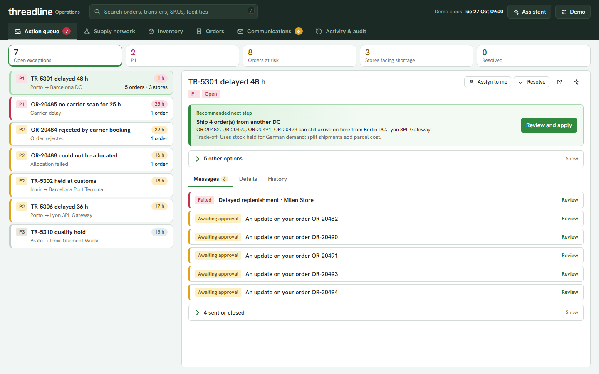
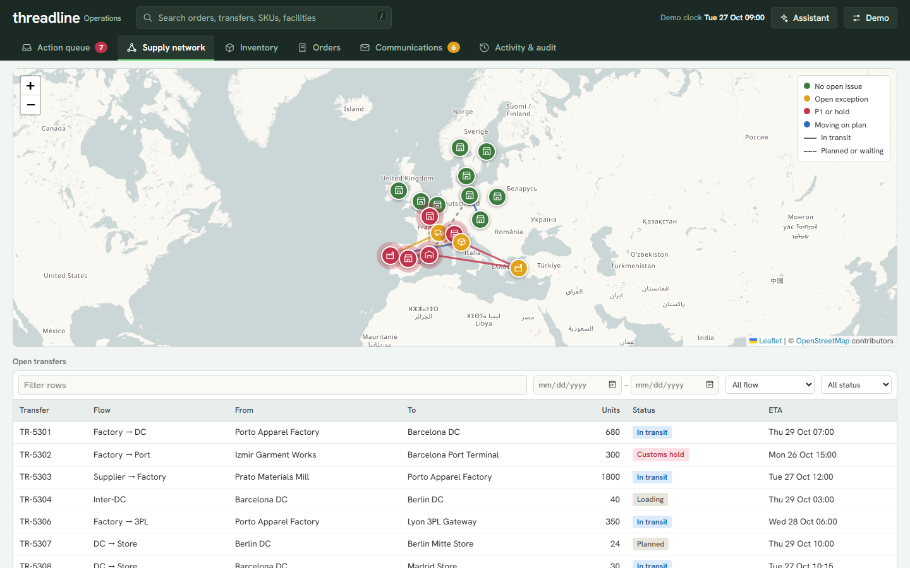
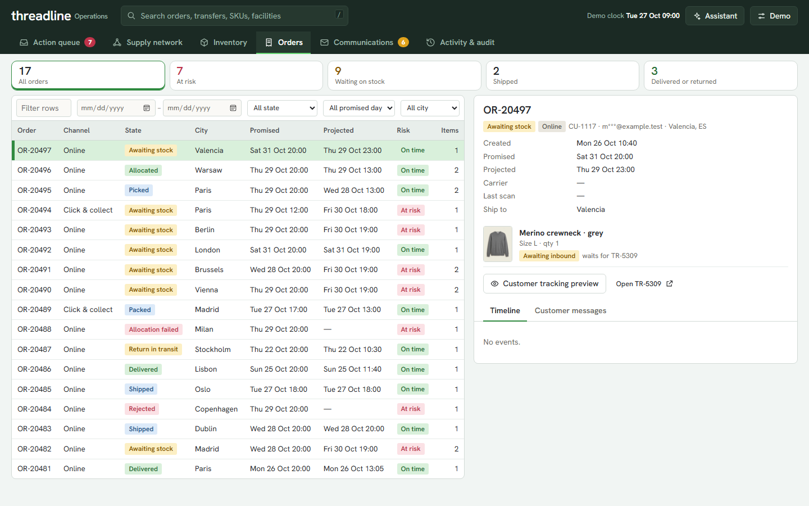
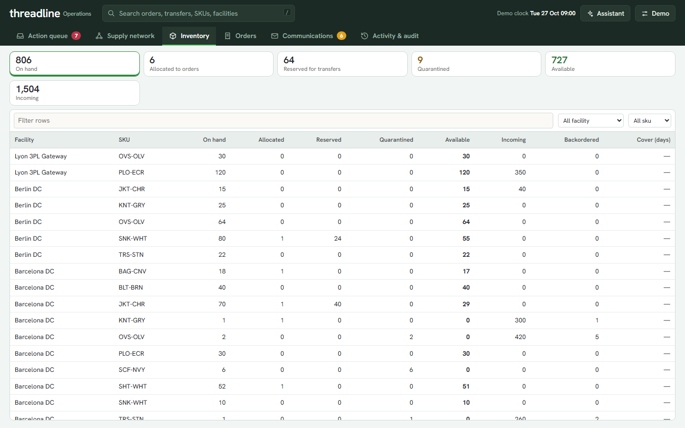
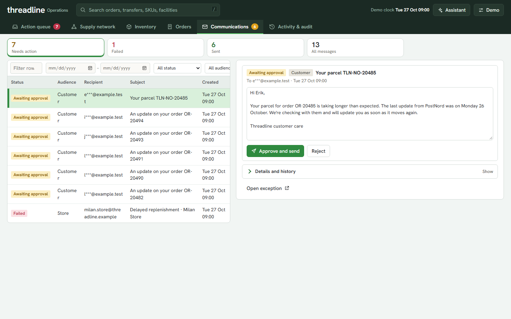
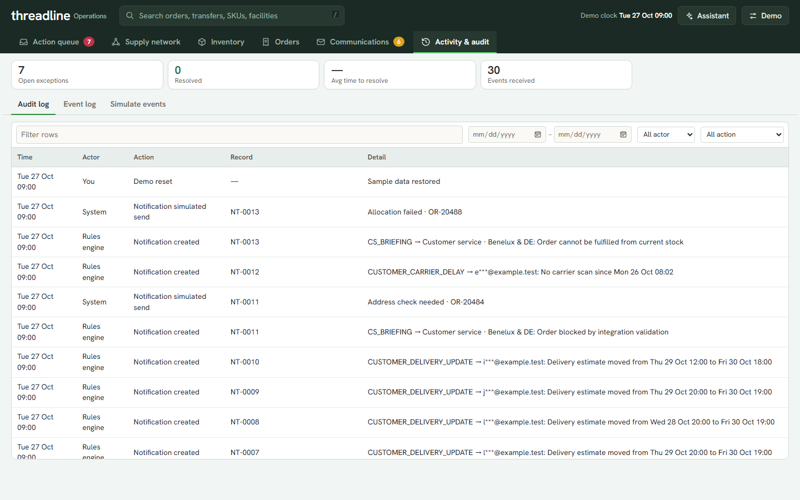

# AI-powered supply-chain exception management

**Threadline Operations** is a working prototype of an exception-resolution desk for a fictional European fashion retailer. When a factory transfer is delayed, an operator can see what it affects, choose a response, approve the messages and track the outcome on one screen.

Everything is simulated. All records are fictional; no real carrier, warehouse, retailer or messaging service is contacted. It runs with no API keys.



## The problem

Supply chains rarely fail in one big way. They fail through many small exceptions: a transfer held at customs, a parcel with no scan for a day, an order that could not be allocated. Each one sits in a different system (transport tracking, warehouse stock, order management, email), so an operator has to open several screens, work out by hand which stores and customers are hit, decide what to do, and write the messages. The cost is slow reaction, missed customer promises and stores that run out of stock before anyone noticed.

## What it does

The test scenario: *a transfer from a factory is delayed. Can an employee identify the affected stores and orders, see the available stock, choose a reasonable response, prepare the notifications and track the outcome without switching between screens?*

1. **Detects** exceptions from events, with stable IDs, priorities (P1 to P3) and duplicate-safe handling.
2. **Shows the impact**: dependent store transfers, projected store stockouts and customer orders that now miss their promise.
3. **Recommends a response**, ranked with trade-offs (ship from another DC, express stock to a store, set honest new dates). Every action asks for confirmation.
4. **Drafts messages** for stores, DCs and customers by rules. Customer messages always wait for human approval.
5. **Keeps an audit log** of every decision and tracks the exception until it resolves.
6. **Optional AI assistant** that reads the selected record and proposes actions through read-only tools. It never acts without operator confirmation. Without an API key a deterministic rules provider answers instead.

## Screens

| | |
|---|---|
|  **Supply network**: factories, ports, DCs and stores on a map with open transfers |  **Orders**: status, risk, projected date, with filters and day range |
|  **Inventory**: on hand, allocated, reserved, quarantined, available |  **Communications**: drafts, approvals, simulated delivery |
|  **Activity and audit**: audit log, event log, simulate events | |

## Why it is relevant

- Exception handling is where planners and customer-service teams spend most of their time, and it is the part most tools leave to spreadsheets and email.
- It shows the pattern many operations products need: **detect, explain impact, recommend, human approves, act, audit**.
- AI is used where it helps (reading context, proposing actions) and kept away from where it is risky (sending messages or moving stock without approval).
- It is also a product-management portfolio piece: the workflow, rules, data model, approvals and tests are all in the repository.

## How it could be adapted and improved

- **Real data**: replace the seed data with connectors to a WMS, TMS and order system; the event engine and the `bridge.py` dispatcher already separate the domain from the data source.
- **Real delivery**: swap the simulated sender for email, Slack or SMS providers behind the existing approval rules.
- **Smarter recommendations**: add costs (expedite, split shipment), service-level penalties and demand forecasts to the option ranking; learn from which options operators accept.
- **Better AI**: let the assistant draft messages in the brand voice and explain why one option beats another, with the same read-only and confirm-first guardrails.
- **Team features**: users and roles, assignment and SLAs, shift hand-over, and notifications to owners.
- **Hardening**: authentication, a real database instead of the JSON state file, idempotent webhooks, and monitoring.
- **Other industries**: the same pattern fits grocery, pharma cold chain, electronics and any business with inbound transfers that feed customer promises.

## Run

```bash
python -m venv .venv
.venv\Scripts\activate          # macOS/Linux: source .venv/bin/activate
pip install -r requirements.txt
python server.py                # then open http://127.0.0.1:8601
```

No API keys needed. Tests: `pytest -q`. On Windows, `START_ON_WINDOWS.bat` does all of this.

## The scenario

Open **Action queue** and select `TR-5301` (420 overshirts and 260 trousers, Porto → Barcelona DC, delayed 48 h).

1. **Response**: ranked options with trade-offs (ship at-risk orders from another DC, send express stock to a store, set honest new dates). The first is the recommendation; each asks for confirmation.
2. **Impact**: dependent store transfers, projected store stockouts and customer orders that now miss their promise. Rows open the order.
3. **Messages**: store, DC and customer-service notices are drafted by rules and sent by the auto-send policy; customer updates wait for your approval. Failed deliveries can be retried.
4. **History**: every decision is in the audit log. Resolve the exception with a note.
5. **Demo → Next event** plays the rest of the scenario, jumps to the record it touched and says what changed (customs release, a duplicate event, a short receipt). Exceptions resolve themselves when their condition clears.

Navigation is the top menu: Action queue · Supply network · Inventory · Orders · Communications · Activity & audit. The assistant opens from the top bar and uses the selected record as context. Search (`/`) finds orders, transfers, facilities and SKUs. **Demo** holds live mode, the auto-send policy and reset.

## Demo controls

Everything in the **Demo** menu in the top bar:

| Control | What it does |
|---|---|
| **Next event** | You step through the scripted scenario one event at a time (28 in total). The app jumps straight to the record the event touched, and a notice (click to dismiss) explains what the event was and what the system did about it: exceptions detected or resolved, messages drafted, stock moved. Use this for a guided walkthrough. |
| **Live demo** | Plays the remaining scenario events automatically, one every 8 seconds, like a hands-free tour: it jumps to each record and shows what changed. It waits while a dialog is open or you are typing, and stops at the end of the scenario or when switched off. |
| **Auto-send internal messages** | A message policy, not an event. On: store, DC and customer-service notices send (simulated) as soon as the rules draft them. Off: every message waits for review. Customer messages always need approval, whatever this is set to. |
| **Reset demo data** | Restores the starting data and clock, and clears the assistant conversation. |
| **Activity & audit → Simulate events** | Your own events instead of the script: delay or hold a transfer, scan or ship an order, or replay an event to see duplicate handling. |

Scripted events and your own events use the same processing, so the results (exceptions, messages, stock, audit entries) behave identically.

## Rules

- **Inventory**: `available = on hand − allocated − reserved − quarantined`. Incoming and in-transit units are never part of on hand. Transfers waiting on upstream stock reserve nothing.
- **Priority**: P1 when a customer promise or store stockout falls within 48 h; P2 for other downstream impact or a delay of 24 h or more; P3 otherwise. Shown in the app under "How priority is set".
- **Store shortage**: units of expected sales between the projected stockout and the new arrival, from each store's average daily sales.
- **Events** have stable ids. A repeated id is logged as a duplicate and changes nothing. Impossible transitions (shipping an unallocated order, departing without stock) are rejected and logged.
- **Messages** carry a dedupe key built from rule, exception, recipient and the facts stated, so reprocessing never duplicates them. When facts change, unsent drafts are superseded.

## One-file version

`python build_standalone.py` writes `dist/threadline-standalone.html`: the whole app in a single file you can email or open by double-clicking, with no server. The Python rules engine runs inside the browser (Pyodide), so every action works. It needs internet on first open (Pyodide ~10 MB, Leaflet, map tiles, fonts). Data lives in the page and resets on reload. Rebuild after changing any Python or frontend file.

## Optional configuration

Copy `.env.example` to `.env`. Nothing here is required.

| Variable | Effect |
|---|---|
| `OPENAI_API_KEY`, `OPENAI_MODEL` | Assistant uses OpenAI tool calling over the same read-only tools. Without it, a rule-based assistant answers from those tools. |
| `CARTO_API_KEY` | Map uses CARTO Voyager instead of OpenStreetMap. Unverified: the `?key=` format is from CARTO's blog and could not be tested without a key. The key is sent to the browser in tile URLs. |
| `THREADLINE_NOTIFY_WEBHOOK_URL` | Internal notifications are POSTed here instead of simulated. Customer messages stay simulated. |

Map tiles come from OpenStreetMap by default; follow its [tile usage policy](https://operations.osmfoundation.org/policies/tiles/) and don't use it for high traffic. The server checks a sample tile and the page warns if tiles can't load. Leaflet is loaded from unpkg and fonts from Google Fonts, so the browser needs internet access. The assistant never executes changes: it proposes, and you confirm.

## Layout

```
server.py       FastAPI app: JSON API + static frontend
views.py        JSON views over the state (derived values computed in Python)
domain.py       inventory arithmetic, impact, sourcing options, exception rules
engine.py       event processing, operator actions, audit, persistence
comms.py        communication rules, dedupe, delivery
assistant.py    tools, rule-based and OpenAI providers
tiles.py        map tile provider and health check
seed.py         fictional dataset and scripted events
models.py       typed records
static/         index.html, app.css, and ES modules (app, pages, table, map, util)
bridge.py       the same API without FastAPI, for the one-file version
build_standalone.py  packs everything into dist/threadline-standalone.html
```

State is saved to `.demo_state.json` (git-ignored). **Demo → Reset demo data** restores the seed. API docs: `/api/docs`.

## Limitations

- Demo data only; no database. State lives in one local file and one process.
- One operator, no authentication. Customer tracking links use the order id; production would need signed, expiring tokens.
- Returns are tracked to restocking for one order; there is no returns page.
- The OpenAI path has not been run end to end here (no key was available); it shares tools with the tested rule-based path.
- Store demand is a daily average; promotions and seasonality are not modelled.
- Checked in Chrome-class browsers at narrow and desktop widths; no automated browser tests, and the frontend has no unit tests.
